# Smart Parking Allocation System (Idam Nagar Commercial District)

An academic, pure Java console-based Smart Parking Allocation and Reservation System demonstrating **Object-Oriented Programming (OOP)**, **Java Collections Framework**, and **Data Structures and Algorithms (Dijkstra's Algorithm, Min-Heap PriorityQueue, Weighted Graph, and Interval Conflict Detection)**.

Designed for academic demonstration and viva presentation with **zero external dependencies**, no database, no GUI, no live sensors, and no web frameworks.

---

## Table of Contents
1. [Project Overview & Case Study](#project-overview--case-study)
2. [Objectives & Core Features](#objectives--core-features)
3. [Project Directory Structure](#project-directory-structure)
4. [OOP Concepts & Architecture](#oop-concepts--architecture)
5. [Data Structures Justification & Time Complexity](#data-structures-justification--time-complexity)
6. [Core Algorithms Explained](#core-algorithms-explained)
   - [Dijkstra's Shortest Path Algorithm (Manual Min-Heap)](#1-dijkstras-shortest-path-algorithm-manual-min-heap)
   - [Interval Conflict Detection Algorithm](#2-interval-conflict-detection-algorithm)
   - [Multi-Step Compatible Nearest-Lot Allocation Engine](#3-multi-step-compatible-nearest-lot-allocation-engine)
   - [State Transition & Grace Period Expiration Engine](#4-state-transition--grace-period-expiration-engine)
7. [UML Class Diagram & Component Flow](#uml-class-diagram--component-flow)
8. [Idam Nagar Road Network & Facility Map](#idam-nagar-road-network--facility-map)
9. [How to Compile and Run](#how-to-compile-and-run)
10. [Automated 20 Synthetic Events & 12 Required Test Cases](#automated-20-synthetic-events--12-required-test-cases)
11. [Sample Console Input and Output](#sample-console-input-and-output)
12. [United Nations Sustainable Development Goals (SDGs)](#united-nations-sustainable-development-goals-sdgs)
    - [SDG 9: Industry, Innovation, and Infrastructure](#sdg-9-industry-innovation-and-infrastructure)
    - [SDG 11: Sustainable Cities and Communities](#sdg-11-sustainable-cities-and-communities)
13. [Limitations & Future Enhancements](#limitations--future-enhancements)

---

## Project Overview & Case Study

The commercial district **"Idam Nagar"** experiences severe traffic congestion and parking mismanagement across its three central parking facilities. The existing manual system creates critical inefficiencies:
1. Drivers are dispatched to occupied or already reserved parking spaces.
2. Incompatible assignments occur (e.g., cars parked in two-wheeler spaces, non-permitted vehicles blocking accessible spaces).
3. Waiting drivers lack a fair, deterministic allocation order during peak demand.
4. Cancelled or no-show reservations remain blocked in manual registers.

### The Solution
This Java-based Smart Parking Allocation System acts as an intelligent coordinator that:
- Maintains a simulated road network model of Idam Nagar using an adjacency-list weighted graph.
- Computes shortest travel times dynamically using Dijkstra's algorithm.
- Strictly validates vehicle compatibility and accessibility permits before allocating slots.
- Enforces strict mathematical interval overlap detection (`newStart < existingEnd && newEnd > existingStart`).
- Manages an automated, deterministic `PriorityQueue` waiting list for saturated demand with automatic preemption for emergency/accessible priority.
- Automatically reconsiders waiting drivers when spaces are freed due to check-out, cancellation, or grace-period expiration.

---

## Objectives & Core Features

- **Fixed Scope Compliance**:
  - Exactly **3 Parking Lots**: `LOT-A` (North Gate Plaza), `LOT-B` (Central Commercial Lot), `LOT-C` (South Metro Terminal).
  - Exactly **24 Parking Spaces**: Balanced distribution across standard Cars, Two-Wheelers, and Accessible spaces.
  - **9 Road Network Nodes** (`N1` to `N9`) with positive edge weights representing travel times in minutes.
- **Strict OOP Hierarchy**:
  - Abstract base class `ParkingSpace` polymorphic subclasses: `CarSpace`, `TwoWheelerSpace`, and `AccessibleSpace`.
  - Strategy/Policy pattern abstraction via `SlotSelectionPolicy`.
- **Zero Incompatible Allocations**:
  - Accessible spaces strictly mandate an authorized accessibility permit.
  - Car spaces accept only four-wheelers; two-wheeler spaces accept only two-wheelers.
- **Interval-Based Reservations**:
  - Driver-specified fixed start and end intervals (in simulated minutes from 00:00).
- **Grace-Period Expiration**:
  - Documented configurable 15-minute grace period (`DEFAULT_GRACE_PERIOD_MINUTES = 15`). Unfulfilled reservations are automatically expired and freed for the waiting list.
- **Role-Based Console Interface**:
  - Interactive **User Menu** (Booking, Check-in, Check-out, Cancellation, Nearest Lot Finder, Status).
  - Interactive **Admin Menu** (Lot & Space Management, Real-time Dashboard, Expiration Processing, Clock Control).
  - One-click **Automated 20 Events & Test Suite Demo Runner** for viva evaluation.

---

## Project Directory Structure

```text
SmartParkingSystem/
├── bin/                             # Compiled Java byte-code (.class files)
├── src/
│   ├── main/
│   │   └── Main.java                # Console UI, role menus, and controller entry point
│   ├── model/
│   │   ├── AccessibleSpace.java     # Subclass enforcing accessibility permit
│   │   ├── CarSpace.java            # Subclass accepting standard cars
│   │   ├── ParkingLot.java          # Composition of parking spaces & lot node mapping
│   │   ├── ParkingRequest.java      # Comparable waiting queue request entity
│   │   ├── ParkingSpace.java        # Abstract base class with state transitions
│   │   ├── Reservation.java         # Booking entity with interval conflict logic
│   │   ├── ReservationStatus.java   # Status enum (RESERVED, CHECKED_IN, COMPLETED, CANCELLED, EXPIRED)
│   │   ├── SpaceStatus.java         # State enum (AVAILABLE, RESERVED, OCCUPIED)
│   │   ├── TwoWheelerSpace.java     # Subclass accepting motorcycles/scooters
│   │   ├── Vehicle.java             # Vehicle entity with type and permit flag
│   │   └── VehicleType.java         # Enum (CAR, TWO_WHEELER)
│   ├── service/
│   │   ├── DefaultSlotSelectionPolicy.java  # Concrete slot selection policy
│   │   ├── ParkingOperationsController.java # Central business logic orchestrator
│   │   ├── ReservationManager.java          # Interval verification, storage & expiration
│   │   └── SlotSelectionPolicy.java         # Abstraction for space selection strategy
│   ├── graph/
│   │   ├── DijkstraAlgorithm.java   # Manual Dijkstra algorithm with Min-Heap PriorityQueue
│   │   ├── Edge.java                # Weighted road connection
│   │   ├── GraphNode.java           # Road intersection / facility node
│   │   └── WeightedGraph.java       # Adjacency list road network graph
│   └── util/
│       └── SampleData.java          # Synthetic road network, 24 spaces & 20-event test suite
└── README.md                        # Comprehensive system documentation
```

---

## OOP Concepts & Architecture

| OOP Concept | Implementation in Code |
| :--- | :--- |
| **Abstraction** | `ParkingSpace` defines the abstract contract `acceptsVehicle(Vehicle vehicle)` and `getSpaceType()`. The caller does not need to know the specific slot layout. `SlotSelectionPolicy` abstracts allocation ranking. |
| **Encapsulation** | All entity fields are `private`. State transitions (`reserve()`, `checkIn()`, `checkOut()`, `cancel()`, `expire()`) enforce preconditions internally and throw `IllegalStateException` on invalid transitions. |
| **Inheritance** | `CarSpace`, `TwoWheelerSpace`, and `AccessibleSpace` inherit common identifiers, lot bindings, and state management from `ParkingSpace`. |
| **Polymorphism** | `slotPolicy.isCompatible(space, vehicle)` dynamically invokes `space.acceptsVehicle(vehicle)`. `AccessibleSpace` verifies `vehicle.hasAccessiblePermit()`, while `CarSpace` verifies `vehicle.getType() == VehicleType.CAR`. |
| **Composition** | `ParkingLot` contains an `ArrayList<ParkingSpace>`. A parking lot is composed of physical parking spaces whose lifecycles are bound to that facility. |

---

## Data Structures Justification & Time Complexity

| Data Structure | Code Usage | Justification & Viva Explanation | Time Complexity |
| :--- | :--- | :--- | :--- |
| **`HashMap<K, V>`** | `vehicleMap`, `spaceMap`, `lotMap`, `reservationMap` | Lookups by ID (e.g. finding vehicle by license plate or reservation by ID) must be instantaneous regardless of system scale. HashMap provides constant-time key-value hashing. | Search/Insert: **$O(1)$** average |
| **`ArrayList<E>`** | `ParkingLot.spaces`, `reservationHistory`, shortest path route nodes | Best suited for ordered sequential storage where index-based access or dynamic appending is frequent. Spaces inside a lot maintain a stable indexing order. | Append: **$O(1)$** amortized, Iteration: **$O(N)$** |
| **`PriorityQueue<E>` (Min-Heap)** | `waitingQueue` (Waiting Drivers) | Drivers waiting for full lots must be dequeued deterministically based on priority first (Access/Emergency = 1, Standard = 2) and request time second. PriorityQueue maintains heap invariant. | Insert / Poll: **$O(\log K)$**, Peek: **$O(1)$** |
| **`WeightedGraph` (Adjacency List)** | `roadNetwork` (Idam Nagar Roads) | Road intersections are vertices; road links are positive weighted edges. Adjacency lists save memory over dense matrices for sparse municipal road networks ($E \ll V^2$). | Space: **$O(V + E)$**, Neighbor lookup: **$O(\text{deg}(V))$** |
| **`PriorityQueue<NodeDistance>`** | Internal Min-Heap in `DijkstraAlgorithm` | Dijkstra requires extracting the unvisited node with minimum tentative distance. A binary min-heap guarantees logarithmic extraction and relaxation. | **$O((V + E) \log V)$** total time |

---

## Core Algorithms Explained

### 1. Dijkstra's Shortest Path Algorithm (Manual Min-Heap)
- **Problem**: Given a driver at origin road node $S$, determine the minimum travel time (and exact node route) to candidate parking lots.
- **Manual Implementation**:
  1. Initialize `distances[node] = ∞`, `distances[source] = 0`.
  2. Insert `NodeDistance(source, 0)` into `PriorityQueue<NodeDistance>` (Min-Heap).
  3. While min-heap is not empty:
     - Extract node $u$ with minimum distance.
     - If $u$ is already settled, continue.
     - For each outgoing edge $(u, v)$ with weight $w$:
       - Calculate $\text{newDist} = \text{distances}[u] + w$.
       - If $\text{newDist} < \text{distances}[v]$:
         - Update $\text{distances}[v] = \text{newDist}$.
         - Record predecessor: $\text{predecessors}[v] = u$.
         - Insert `NodeDistance(v, newDist)` into min-heap.
  4. Path route is reconstructed by backtracking from target node through `predecessors` map to source.

### 2. Interval Conflict Detection Algorithm
- **Problem**: Prevent double-booking for the same parking space during overlapping hours.
- **Mathematical Condition**: Two time intervals $[S_{\text{new}}, E_{\text{new}}]$ and $[S_{\text{existing}}, E_{\text{existing}}]$ conflict if and only if:
  $$\text{newStart} < \text{existingEnd} \quad \text{AND} \quad \text{newEnd} > \text{existingStart}$$
- **Lifecycle Integration**:
  - Completed, Cancelled, and Expired reservations are filtered out (`isActiveSlot()` returns false).
  - Only `RESERVED` and `CHECKED_IN` reservations block the space interval.

### 3. Multi-Step Compatible Nearest-Lot Allocation Engine
To prevent directing drivers to full lots or discovering incompatibility after routing, the system strictly executes this workflow:
1. **Input Validation**: Check vehicle registration, valid interval ($S < E$), driver origin node.
2. **Compatibility Filtering**: For all lots, filter spaces matching `slotPolicy.isCompatible(space, vehicle)`.
3. **Occupancy & Conflict Pruning**: Remove spaces currently occupied or with overlapping active reservations.
4. **Lot Eligibility**: Group remaining compatible spaces by lot. If zero lots qualify, immediately insert the request into the `waitingQueue` (PriorityQueue).
5. **Dijkstra Calculation**: Compute shortest travel times from driver's origin to all eligible lot location nodes.
6. **Nearest Lot Selection**: Pick the lot with minimum travel time.
7. **Best Space Picking**: Use `slotPolicy.selectBestSpace(...)` (prioritizing dedicated Accessible spaces for permit holders).
8. **Instant Reservation**: Mark space as `RESERVED`, store reservation record, and display confirmed travel route.

### 4. State Transition & Grace Period Expiration Engine
- **State Transition Graph**:
  $$\text{AVAILABLE} \xrightarrow{\text{reserve()}} \text{RESERVED} \xrightarrow{\text{checkIn()}} \text{OCCUPIED} \xrightarrow{\text{checkOut()}} \text{AVAILABLE}$$
  $$\text{RESERVED} \xrightarrow{\text{cancel()}} \text{AVAILABLE} \quad \text{and} \quad \text{RESERVED} \xrightarrow{\text{expire()}} \text{AVAILABLE}$$
- **Grace Period**: If driver fails to check in before $\text{startTime} + 15\text{ mins}$, `processExpiredReservations()` changes status to `EXPIRED`, resets space to `AVAILABLE`, and triggers waiting-list reconsideration.

---

## UML Class Diagram & Component Flow

```mermaid
classDiagram
    direction TB

    class Vehicle {
        -String vehicleId
        -String ownerName
        -VehicleType type
        -boolean accessiblePermit
        +getVehicleId() String
        +getType() VehicleType
        +hasAccessiblePermit() boolean
    }

    class VehicleType {
        <<enumeration>>
        CAR
        TWO_WHEELER
    }

    class SpaceStatus {
        <<enumeration>>
        AVAILABLE
        RESERVED
        OCCUPIED
    }

    class ReservationStatus {
        <<enumeration>>
        RESERVED
        CHECKED_IN
        COMPLETED
        CANCELLED
        EXPIRED
    }

    class ParkingSpace {
        <<abstract>>
        -String spaceId
        -String lotId
        -SpaceStatus status
        +reserve() void
        +checkIn() void
        +checkOut() void
        +cancel() void
        +expire() void
        +acceptsVehicle(Vehicle v)* boolean
        +getSpaceType()* String
    }

    class CarSpace {
        +acceptsVehicle(Vehicle v) boolean
        +getSpaceType() String
    }

    class TwoWheelerSpace {
        +acceptsVehicle(Vehicle v) boolean
        +getSpaceType() String
    }

    class AccessibleSpace {
        +acceptsVehicle(Vehicle v) boolean
        +getSpaceType() String
    }

    ParkingSpace <|-- CarSpace
    ParkingSpace <|-- TwoWheelerSpace
    ParkingSpace <|-- AccessibleSpace
    ParkingSpace --> SpaceStatus

    class ParkingLot {
        -String lotId
        -String lotName
        -String locationNode
        -ArrayList~ParkingSpace~ spaces
        +addSpace(ParkingSpace s) void
        +getSpaces() ArrayList
        +getSpaceById(String id) ParkingSpace
    }

    ParkingLot *-- ParkingSpace : contains (Composition)

    class Reservation {
        -String reservationId
        -Vehicle vehicle
        -ParkingSpace space
        -int startTime
        -int endTime
        -ReservationStatus status
        +overlaps(int newStart, int newEnd) boolean
        +checkIn() void
        +checkOut() void
        +cancel() void
        +expire() void
    }

    Reservation --> Vehicle : references
    Reservation --> ParkingSpace : references
    Reservation --> ReservationStatus

    class ParkingRequest {
        -String requestId
        -Vehicle vehicle
        -int requestTime
        -int accessPriority
        -int requestedStartTime
        -int requestedEndTime
        -String originNode
        -String status
        +compareTo(ParkingRequest o) int
    }

    ParkingRequest --> Vehicle : references

    class SlotSelectionPolicy {
        <<interface>>
        +isCompatible(ParkingSpace s, Vehicle v) boolean
        +selectBestSpace(List~ParkingSpace~ c, Vehicle v) ParkingSpace
    }

    class DefaultSlotSelectionPolicy {
        +isCompatible(ParkingSpace s, Vehicle v) boolean
        +selectBestSpace(List~ParkingSpace~ c, Vehicle v) ParkingSpace
    }

    SlotSelectionPolicy <|.. DefaultSlotSelectionPolicy

    class WeightedGraph {
        -Map~String, GraphNode~ nodes
        -Map~String, List~Edge~~ adjacencyList
        +addNode(String id, String name) void
        +addEdge(String u, String v, int w, boolean b) void
        +getNeighbors(String id) List
    }

    class DijkstraAlgorithm {
        +computeAllShortestPaths(WeightedGraph g, String src) Map
        +findShortestPath(WeightedGraph g, String src, String tgt) ShortestPathResult
    }

    class ReservationManager {
        -Map~String, Reservation~ reservationMap
        -List~Reservation~ reservationHistory
        +hasOverlappingReservation(String spaceId, int s, int e) boolean
        +createReservation(Vehicle v, ParkingSpace s, int st, int et, int ct) Reservation
        +cancelReservation(String id) Reservation
        +checkIn(String id, int ct) Reservation
        +checkOut(String id) Reservation
        +processExpiredReservations(int ct, int grace) List
    }

    class ParkingOperationsController {
        -Map~String, ParkingLot~ lotMap
        -Map~String, ParkingSpace~ spaceMap
        -Map~String, Vehicle~ vehicleMap
        -PriorityQueue~ParkingRequest~ waitingQueue
        -WeightedGraph roadNetwork
        -ReservationManager reservationManager
        -SlotSelectionPolicy slotPolicy
        +requestParkingAllocation(String vId, String node, int s, int e, int prio) AllocationResult
        +checkIn(String resId, String vId) Reservation
        +checkOut(String resId) Reservation
        +cancelReservation(String resId) Reservation
        +reconsiderWaitingList() List
    }

    ParkingOperationsController o-- ParkingLot : manages
    ParkingOperationsController o-- ReservationManager : manages
    ParkingOperationsController o-- ParkingRequest : queues in PriorityQueue
    ParkingOperationsController --> DijkstraAlgorithm : uses
    ParkingOperationsController --> SlotSelectionPolicy : uses
    DijkstraAlgorithm --> WeightedGraph : traverses
```



---

## Idam Nagar Road Network & Facility Map

```text
    [N1: North Gateway]
       /             \
 (4 min)            (7 min)
     /                 \
 [N2: Market] ------ (3 min) ------ [N3: Civic Centre]
   |    \                             /       |
(6 min)  \                          (4 min) (5 min)
   |     (3 min)                      /       |
   |        \                        /        |
   |     [N4: Tech Boulevard] ------/         |
   |              |                           |
   |           (2 min)                        |
   |              |                           |
   |         [N5: Central Square] ------------+
   |              |        \
(4 min)        (3 min)     (5 min)
   |              |            \
   v              v             v
[LOT-A (N6)]   [N7: Financial]  [LOT-B (N8)]
North Gate        |       \           |
Plaza          (5 min)    (3 min)  (4 min)
                  |           \       |
                  +------------> [LOT-C (N9)]
                                South Metro Terminal
```

### Facilities and Assigned Spaces (Total: 24 spaces)
1. **LOT-A: North Gate Plaza (Node N6)**
   - 5 Car Spaces: `A-C01`, `A-C02`, `A-C03`, `A-C04`, `A-C05`
   - 2 Two-Wheeler Spaces: `A-T01`, `A-T02`
   - 1 Accessible Space: `A-ACC1`
2. **LOT-B: Central Commercial Lot (Node N8)**
   - 4 Car Spaces: `B-C01`, `B-C02`, `B-C03`, `B-C04`
   - 3 Two-Wheeler Spaces: `B-T01`, `B-T02`, `B-T03`
   - 1 Accessible Space: `B-ACC1`
3. **LOT-C: South Metro Terminal (Node N9)**
   - 4 Car Spaces: `C-C01`, `C-C02`, `C-C03`, `C-C04`
   - 3 Two-Wheeler Spaces: `C-T01`, `C-T02`, `C-T03`
   - 1 Accessible Space: `C-ACC1`

---

## How to Compile and Run

### Prerequisites
- Java Development Kit (JDK 8 or above, JDK 17/21/26 recommended).
- Windows Command Prompt or PowerShell (or Linux/macOS bash shell).

### 1. Compile the Project
Open terminal in the project root directory (`SmartParkingSystem/`):

```powershell
# Windows PowerShell
javac -d bin (Get-ChildItem -Recurse -Filter *.java src | ForEach-Object { $_.FullName })
```
Or standard cross-platform syntax:
```bash
# Windows CMD / Linux / macOS
javac -d bin src/model/*.java src/graph/*.java src/service/*.java src/util/*.java src/main/*.java
```

### 2. Run the Application
```bash
java -cp bin main.Main
```

---

## Automated 20 Synthetic Events & 12 Required Test Cases

To demonstrate the full system during viva evaluation, select Option `3` from the Main Menu (`Run 20 Automated Simulation Events & Test Suite`). All 12 required academic test cases execute deterministically:

| Event / Test Case | Description & Action | Expected Outcome | System Result |
| :---: | :--- | :--- | :---: |
| **TEST 1 & 12** | Driver at Node N1 requests slot 09:00 - 11:00 | Dijkstra evaluates N1 $\to$ LOT-A (N6), LOT-B (N8), LOT-C (N9). Selects nearest reachable lot (LOT-A, 10 min route). | **PASS** |
| **TEST 2** | Two-wheeler vehicle requesting standard CarSpace | Polymorphic `CarSpace.acceptsVehicle(TwoWheeler)` returns `false`. Incompatible space rejected. | **PASS** |
| **TEST 3** | Car driver without permit requesting AccessibleSpace | Polymorphic `AccessibleSpace.acceptsVehicle(Car)` returns `false`. Enforces accessibility permit strictly. | **PASS** |
| **TEST 4** | Driver with authorized accessibility permit requests slot | Allocates dedicated `AccessibleSpace` (`A-ACC1`) in nearest lot. | **PASS** |
| **TEST 5** | Booking overlapping interval (09:30 - 10:30) on space `A-C01` | Formula `newStart < end && newEnd > start` flags overlap. Booking prevented. | **PASS** |
| **TEST 6** | LOT-A Car spaces saturated; new car driver requests slot | System detects LOT-A has no compatible free space; reroutes via Dijkstra to LOT-B (`B-C01`). | **PASS** |
| **TEST 7** | All car spaces across LOT-A, LOT-B, and LOT-C booked | Request cannot be allocated; queued in `PriorityQueue<ParkingRequest>` (`REQ-101`). | **PASS** |
| **TEST 8** | Active reservation on Car space `B-C01` is cancelled | Status becomes `CANCELLED`. Space freed; `reconsiderWaitingList()` auto-allocates to waiting queue driver! | **PASS** |
| **TEST 9** | Vehicle arrives for reservation `RES-1001` | Reservation transitions `RESERVED` $\to$ `CHECKED_IN`; Space transitions `RESERVED` $\to$ `OCCUPIED`. | **PASS** |
| **TEST 10** | Vehicle checks out from space `A-C01` | Reservation transitions `CHECKED_IN` $\to$ `COMPLETED`; Space released to `AVAILABLE`; Waiting list reconsidered. | **PASS** |
| **TEST 11** | Clock advances past 15-minute grace period (to 10:00) | Unfulfilled 09:00 reservations transition to `EXPIRED`; Spaces released to `AVAILABLE`. | **PASS** |
| **TEST 12** | Driver at Node N7 tests nearest lot | Dijkstra computes travel times: LOT-A (6 min), LOT-B (3 min), LOT-C (5 min). Selects LOT-B. | **PASS** |

---

## Sample Console Input and Output

### Interactive Booking Flow Example
```text
====================================
        DRIVER / USER MENU          
Simulated Clock: 08:00
====================================
1. Book Parking (Compatible Nearest Lot)
2. Cancel Reservation
3. Find Nearest Parking Lot (Dijkstra)
4. Check-in (Arrival)
5. Check-out (Departure)
6. View My Reservation
7. View Parking Status
8. View Waiting List
9. Return to Main Menu
Select an option (1-9): 1

--- BOOK PARKING SPACE ---
Enter Vehicle Registration ID (e.g. TN-01-AB-1234): TN-01-AB-1234
Identified Vehicle: [TN-01-AB-1234] Owner: Anand Kumar  Type: CAR         Accessible Permit: NO

Road Network Nodes available: N1 to N9
(N1: North Gateway, N2: Market, N3: Civic Centre, N4: Tech Blvd, N5: Central Sq,
 N6: Lot A, N7: Financial Dist, N8: Lot B, N9: Lot C)
Enter your current road node (e.g. N1): N1
Enter requested start time (HH:MM or minutes 0-1439, e.g. 09:00): 09:00
Enter requested end time (HH:MM or minutes 0-1439, e.g. 11:00): 11:00

Processing allocation request through multi-step rule engine...

=======================================================
          PARKING ALLOCATION SUCCESSFUL!               
=======================================================
Reservation ID   : RES-1001
Selected Lot     : North Gate Plaza (LOT-A)
Assigned Space   : A-C01 [Type: CAR]
Time Interval    : 09:00 - 11:00
Estimated Travel : 10 mins (via Dijkstra)
Shortest Route   : N1 -> N2 -> N6
=======================================================
```

---

## United Nations Sustainable Development Goals (SDGs)

### SDG 9: Industry, Innovation, and Infrastructure
- **Target 9.1 & 9.4**: Development of quality, reliable, sustainable, and resilient municipal infrastructure.
- **Project Contribution**: Replaces static, uncoordinated physical parking lots with an algorithmic routing system. By integrating Dijkstra shortest-path calculations directly into parking slot dispatch, drivers take optimal physical routes, reducing unnecessary wear on municipal roadways and optimizing public land asset utilization.

### SDG 11: Sustainable Cities and Communities
- **Target 11.2 & 11.6**: Affordable, accessible transport systems and reduction of municipal environmental impact.
- **Target 11.7**: Universal access to inclusive, accessible urban spaces for vulnerable populations and persons with disabilities.
- **Project Contribution**:
  1. **Cruising Traffic Reduction**: Studies show up to 30% of downtown commercial traffic is caused by drivers searching for open parking. By pre-allocating the nearest compatible space before arrival, idle cruising time, fuel burn, and vehicular carbon emissions are minimized.
  2. **Dedicated Accessibility Protection**: Built-in polymorphic enforcement ensures designated accessible parking spaces are safeguarded for certified permit holders and never misallocated to non-permitted vehicles.

---

## Limitations & Future Enhancements

### Limitations (Academic Scope)
- **In-Memory Volatility**: Data is retained in JVM memory (HashMap/ArrayList) and resets upon application restart.
- **Simulated Clock**: Uses operator-advanced simulated minutes rather than wall-clock synchronization.
- **Static Edge Weights**: Edge weights reflect average baseline travel times rather than dynamic traffic congestion spikes.

### Future Enhancements
- **Persistent Storage**: Integration with JDBC/PostgreSQL for long-term audit logging and historical analytics.
- **Dynamic Congestion Weights**: Time-of-day edge weight multipliers reflecting peak-hour traffic jams in Dijkstra calculations.
- **Automated License Plate Recognition (ALPR)**: Camera integration at boom barriers for zero-touch automatic check-in/out.
- **Payment & Variable Pricing Gateway**: Dynamic pricing where peak demand slots or inner-ring lots carry variable congestion tariffs.
